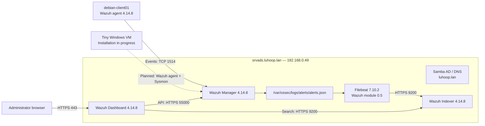

# homelab-cyberdefense

## Overview

This project documents the design, deployment, and security monitoring of a personal cybersecurity homelab.

The main objective is to build a realistic Active Directory environment, simulate common cyberattacks, and understand how to detect and mitigate them.

This homelab is also an opportunity to improve my practical skills in system administration, networking, and defensive cybersecurity.

Last documentation update: **2026-11-21** (Europe/Paris).

## Hardware Infrastructure

| Device | Operating System | RAM | Role |
|---|---|---|---|
| Dell OptiPlex 9020 | Debian 12 | 8 GB | Main server: Samba AD and Wazuh central components |
| Secondary PC | Windows | 4 GB | Originally listed as an Active Directory client; current domain membership not revalidated |
| Debian client | Debian; exact release to confirm | To confirm | Wazuh endpoint named `debian-client01` |
| Tiny Windows VM | Exact Windows edition/build to confirm | To confirm | Installation in progress; planned Wazuh and Sysmon endpoint |

The main server runs continuously and hosts the core infrastructure. The relationship between the original secondary PC and the new Windows VM has not been confirmed.

## Technologies

- **Samba Active Directory:** Domain controller, DNS, and identity management.
- **Wazuh Manager 4.14.8:** Event analysis, rules, alerts, and agent management.
- **Wazuh Indexer 4.14.8:** Alert storage and search.
- **Filebeat 7.10.2 with Wazuh module 0.5:** Alert forwarding from Manager to Indexer.
- **Wazuh Dashboard 4.14.8:** Web interface for investigations and administration.
- **Wazuh Debian agent 4.14.8:** Endpoint monitoring; local startup confirmed in the earlier installation record.
- **Sysmon:** Planned Windows telemetry; installation not yet confirmed.
- **Tailscale:** Secure remote access to the infrastructure.
- **Docker:** Containerized applications and services.
- **Ansible:** Planned infrastructure automation; no completed playbooks verified.
- **pfSense:** Network segmentation and firewall management (planned).

The central stack versions above describe the project installation record, not a new package inventory. Earlier logs explicitly identify the Debian agent and Indexer packages as `4.14.8-1`; confirm the other installed package revisions with the commands below. Filebeat's version is independent of the Wazuh version.

## Active Directory Environment

- Domain: `luhoop.lan`
- Domain Controller: `srvads.luhoop.lan`
- Server LAN address: `192.168.0.49` (recorded address; verify if changed)
- Operating System: Debian 12
- Authentication: Kerberos
- Directory Services: Samba AD

Samba AD and its LDAP/Kerberos DNS records were verified after resolving a Pi-hole port conflict. Windows domain join and ingestion of Samba authentication logs still need separate validation.

## Security Monitoring Architecture

The Wazuh central services share `srvads` with Samba AD. This is a single-host learning environment; it does not provide high availability. Docker is part of the wider homelab, but the recorded Wazuh deployment uses Debian packages and systemd services.



The diagram describes the configured/reported design. It does not establish that every connection has passed an end-to-end test. Sysmon writes Windows events; the Windows Wazuh agent will collect them. Filebeat reads the Manager's JSON alerts and sends them to the Indexer. If Filebeat stops, the Manager can still generate local alerts, but new alerts will not reach the Indexer through this pipeline until forwarding resumes. See the [Wazuh architecture reference](https://documentation.wazuh.com/current/getting-started/architecture.html).

| Connection | Port | Purpose |
|---|---|---|
| Agents → Manager | TCP 1514 | Event delivery |
| Agents → Manager | TCP 1515 | Enrollment, when enabled |
| Filebeat / Dashboard → Indexer | TCP 9200, HTTPS | Ingestion and search |
| Dashboard → Manager API | TCP 55000, HTTPS | Agent management and API authentication |
| Browser → Dashboard | TCP 443, HTTPS | Web interface |
| Clients → Samba DNS | TCP/UDP 53 | AD DNS resolution |

These are the relevant Wazuh defaults and the recorded Dashboard port; verify listeners and firewall rules. The table is not a complete list of Active Directory ports.

## Wazuh Installation Record

This section summarizes the installation and its dependencies. It is not a transcript of every command executed. Current upstream guides may show a later release; this project records **4.14.8**, not an upgrade.

1. **Indexer:** Install `wazuh-indexer` 4.14.8, configure the single node `node-1`, deploy its certificate/key and CA, and initialize Indexer security. The intended data directory is `/home/wazuh-indexer-data`, chosen because `/var` had limited free space. The final configuration and current cluster health still need readback.
2. **Manager:** Install `wazuh-manager` 4.14.8 on `srvads`. Its files are stored in `/home/wazuh-manager` and exposed at `/var/ossec` through a bind mount. That mount must be available before the service starts. Recovery after reboot is documented in [troubleshooting.md](troubleshooting.md#15-manager-bind-mount-missing-after-reboot).
3. **Filebeat:** Install Filebeat 7.10.2, configure the Indexer endpoint, use the Wazuh 4.14.8 JSON template and Wazuh Filebeat module 0.5, deploy the Filebeat certificate/key and CA, and populate its credential keystore. Validate configuration and output before checking alert delivery.
4. **Dashboard:** Install `wazuh-dashboard` 4.14.8, configure HTTPS and the Indexer connection, synchronize the `kibanaserver` service credential, and configure the separate Manager API connection. Dashboard access was reported working after the credential correction.
5. **Debian agent:** Install agent 4.14.8 on the Debian client with Manager address `192.168.0.49` and agent name `debian-client01`. The agent service was confirmed active on 2026-10-11. Manager-side connection and a searchable test alert remain to be captured.

The package installation pattern below is for a **new Debian deployment**, after configuring the official Wazuh APT repository and confirming these exact versions are available. Do not rerun it as a repair procedure on this existing server.

```bash
# On a new server; inspect available versions first.
apt-cache policy wazuh-indexer wazuh-manager wazuh-dashboard filebeat
# Install and configure in dependency order, following the guides linked below.
apt-get install wazuh-indexer=4.14.8-1
apt-get install wazuh-manager=4.14.8-1
# Install Filebeat separately using its verified 7.10.2 Debian package revision.
apt-get install wazuh-dashboard=4.14.8-1

# On a separate new Debian endpoint, after repository setup.
WAZUH_MANAGER="192.168.0.49" WAZUH_AGENT_NAME="debian-client01" \
  apt-get install wazuh-agent=4.14.8-1
systemctl enable --now wazuh-agent
```

Package installation alone does not complete certificate deployment, security initialization, enrollment, or verification. References: [Indexer installation](https://documentation.wazuh.com/current/installation-guide/wazuh-indexer/step-by-step.html), [Manager and Filebeat installation](https://documentation.wazuh.com/current/installation-guide/wazuh-server/step-by-step.html), [Dashboard installation](https://documentation.wazuh.com/current/installation-guide/wazuh-dashboard/step-by-step.html), and [Linux agent installation](https://documentation.wazuh.com/current/installation-guide/wazuh-agent/wazuh-agent-package-linux.html).

The exact Filebeat Debian package revision used in this lab is not recorded. The current [Wazuh package list](https://documentation.wazuh.com/current/installation-guide/packages-list.html) lists `7.10.2-2`; do not infer the installed revision from the upstream version number `7.10.2` alone.

### Configuration and Storage

| Component | Configuration / storage |
|---|---|
| Manager | `/var/ossec/etc/ossec.conf`; `/var/ossec` bind-mounted from `/home/wazuh-manager` |
| Indexer | `/etc/wazuh-indexer/opensearch.yml`; intended `path.data: /home/wazuh-indexer-data` |
| Filebeat | `/etc/filebeat/filebeat.yml`; `/etc/filebeat/wazuh-template.json`; `/usr/share/filebeat/module/wazuh/` |
| Indexer TLS | `/etc/wazuh-indexer/certs/`; configured names must match deployed files |
| Filebeat TLS | `/etc/filebeat/certs/` |
| Dashboard | `/etc/wazuh-dashboard/opensearch_dashboards.yml`; `/etc/wazuh-dashboard/certs/` |
| Dashboard → Manager API | `/usr/share/wazuh-dashboard/data/wazuh/config/wazuh.yml` |
| Debian agent | `/var/ossec/etc/ossec.conf` on the client |

The Filebeat keystore, Dashboard keystore, Manager Indexer-connector keystore, and Manager API credentials are separate settings. Do not assume that correcting one updates the others. Keep passwords, tokens, agent enrollment keys, private keys, keystores, and certificate archives out of this repository.

## Access and Routine Verification

Recorded LAN Dashboard URL: **[https://192.168.0.49](https://192.168.0.49)**. Use the configured Indexer login credentials; no password is stored in this documentation. The recorded Dashboard binding is the LAN address, so direct access through the server's Tailscale address is not assumed to work.

Run these checks on **srvads** as root or with equivalent privileges:

```bash
date --iso-8601=seconds
dpkg-query -W -f='${Package}\t${Version}\n' \
  wazuh-manager wazuh-indexer wazuh-dashboard filebeat
findmnt --mountpoint /var/ossec
findmnt --fstab --target /var/ossec
test -x /var/ossec/bin/wazuh-control && echo "Manager binary available"
systemctl is-active samba-ad-dc wazuh-manager wazuh-indexer filebeat wazuh-dashboard
systemctl is-enabled wazuh-manager wazuh-indexer filebeat wazuh-dashboard
/var/ossec/bin/agent_control -l
filebeat test config -e
filebeat test output -e
ss -lntp | grep -E ':(443|1514|1515|55000|9200)\b'
df -h /var /home /var/ossec
```

Check Indexer authentication and health separately; `curl` prompts for the password:

```bash
curl --fail --show-error --cacert /etc/wazuh-indexer/certs/root-ca.pem \
  --user admin 'https://192.168.0.49:9200/_cluster/health?pretty'
```

The certificate must cover the address used. Record the actual health, node count, and shard state; a running service or successful TCP connection alone does not prove ingestion. See [verification and evidence](troubleshooting.md#17-verification-and-evidence).

On **debian-client01**:

```bash
dpkg-query -W -f='${Package}\t${Version}\n' wazuh-agent
systemctl status wazuh-agent --no-pager -l
tail -n 80 /var/ossec/logs/ossec.log
```

## Security Scenarios

The following scenarios are planned; no completed attack simulation or detection result is claimed yet.

### Scenario 1 — Kerberoasting

Simulate a Kerberoasting attack against a deliberately vulnerable service account, analyze Kerberos authentication events, and develop detection mechanisms.

MITRE ATT&CK: T1558.003

### Scenario 2 — Password Spraying

Simulate password spraying against test accounts, analyze authentication failures, and implement detection rules.

MITRE ATT&CK: T1110.003

## Project Status

| Area | Status as of 2026-11-21 |
|---|---|
| Samba AD / DNS | Service and LDAP/Kerberos SRV resolution confirmed in the earlier record; persistent Pi-hole separation remains unverified |
| Wazuh central stack | 4.14.8 installation reported complete; fresh package/service inventory pending |
| Manager reboot incident | User confirmed operation restored after bind-mount recovery; `/etc/fstab` readback and a subsequent reboot test not captured |
| Filebeat template, module, TLS, and keystore fixes | Reported resolved in the project handoff; detailed successful command output unavailable |
| Dashboard `kibanaserver` authentication | Reported resolved; earlier recap states Dashboard opened successfully |
| Debian agent | Local service confirmed active; Manager-side status and end-to-end alert evidence pending |
| Tiny Windows VM | **Installation in progress**; OS completion, domain join, agent, and Sysmon not confirmed |
| Detection scenarios | Planned |

No live connection to the homelab was made during this documentation update. Detailed evidence limits and corrective procedures are recorded in [troubleshooting.md](troubleshooting.md). The existing `arbo.txt` remains a proposed repository structure; its listed files and directories should not be interpreted as completed deliverables.

## Next Steps — Windows Agent and Sysmon

1. Finish the Tiny Windows VM installation and record its actual edition/build, hostname, resources, and network settings. Confirm required Windows services and compatibility; do not assume a modified image has every component available.
2. Check connectivity to the Manager, DNS, and time synchronization. Join `luhoop.lan` only if the selected Windows edition supports it. Agent monitoring can be validated separately from domain membership.
3. Install a compatible Wazuh agent, targeting 4.14.8 for this recorded stack, and enroll it with `192.168.0.49`. Choose and record a unique agent name. Follow the [Windows agent deployment guide](https://documentation.wazuh.com/current/installation-guide/wazuh-agent/wazuh-agent-package-windows.html) without automatically adopting a newer package shown there.
4. Install Sysmon from [Microsoft Sysinternals](https://learn.microsoft.com/en-us/sysinternals/downloads/sysmon) using a reviewed configuration. Record the Sysmon version and configuration revision. Confirm the `Microsoft-Windows-Sysmon/Operational` channel contains events.
5. Add the following block inside the agent's existing `<ossec_config>` element, unless the channel is already configured locally or centrally. The usual configuration path is `C:\Program Files (x86)\ossec-agent\ossec.conf`.

```xml
<localfile>
  <location>Microsoft-Windows-Sysmon/Operational</location>
  <log_format>eventchannel</log_format>
</localfile>
```

This uses Wazuh's [Windows event-channel collection](https://documentation.wazuh.com/current/user-manual/capabilities/log-data-collection/configuration.html). After installation/configuration, run in elevated PowerShell:

```powershell
Test-NetConnection 192.168.0.49 -Port 1514
Test-NetConnection 192.168.0.49 -Port 1515
Restart-Service WazuhSvc
Get-Service WazuhSvc
Get-WinEvent -LogName 'Microsoft-Windows-Sysmon/Operational' -MaxEvents 5
```

6. Verify the agent is active on the Manager, then generate a harmless test process and trace its Sysmon event through collection and an appropriate Wazuh rule to a searchable alert. A collected event does not necessarily produce an alert; record the matching rule, timestamp, and agent name. Check Dashboard time filters before concluding data is missing.
7. Capture sanitized evidence for Debian SSH authentication and Windows telemetry before moving to the planned AD scenarios. Keep Samba AD audit configuration and Windows Security auditing as separate validation tasks; Sysmon does not replace either.

## Disclaimer

All security testing is performed in an isolated, authorized lab environment for educational purposes only.
